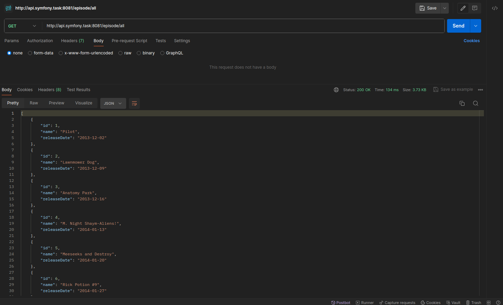
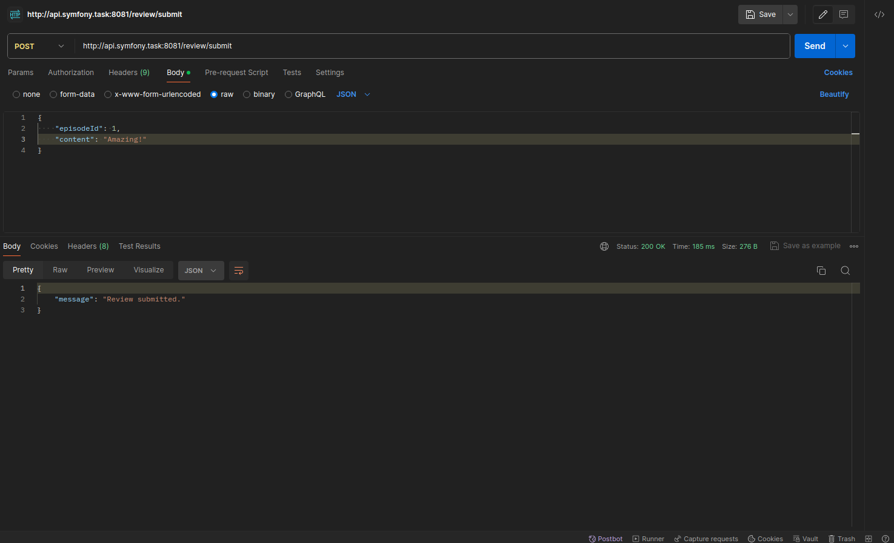
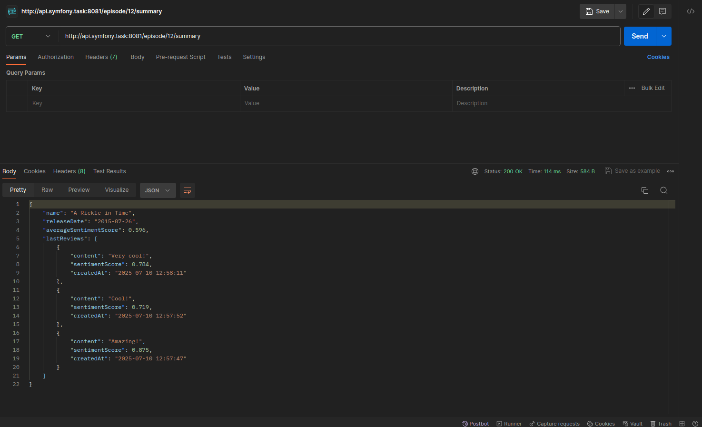

# Rick and Morty episode reviews API

Это API на Symfony, позволяющее работать с эпизодами и отзывами сериала Рик и Морти.
Ниже описаны шаги по первому запуску проекта и доступные эндпоинты.

---

## Первый запуск

1. Убедитесь, что у вас установлен `make`.

2. Запустите команду и дождитесь завершения:
   ```bash
   make first-init
   ```

3. Добавьте в файл `etc/hosts` следующую строку:
   ```
   127.0.0.1 api.symfony.task
   ```

4. После этого API будет доступен по адресу: `http://api.symfony.task:8081`

---

## Доступные эндпоинты

### 1. Получить список всех эпизодов

**GET**
```
http://api.symfony.task:8081/episode/all
```

Возвращает список всех эпизодов из базы данных (ранее подгруженных из внешнего API).

---

### 2. Оставить отзыв на эпизод

**POST**
```
http://api.symfony.task:8081/review/submit
```

Пример запроса с использованием `curl`:
```bash
curl --location 'http://api.symfony.task:8081/review/submit' \
--header 'Content-Type: application/json' \
--data '{
    "episodeId": 1,
    "content": "Amazing!"
}'
```

Параметры:
- `episodeId` – ID эпизода, к которому оставляется отзыв
- `content` – текст отзыва

---

### 3. Получить сводку по эпизоду

**GET**
```
http://api.symfony.task:8081/episode/{episodeId}/summary
```

Пример:
```
http://api.symfony.task:8081/episode/1/summary
```

Возвращает краткую информацию о выбранном эпизоде по его ID.

Ответы на запросы:






